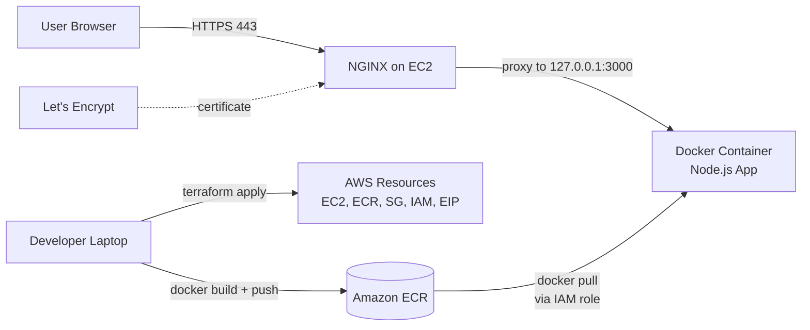

# Deploy a Node.js App on AWS with Terraform, Docker, NGINX & SSL


A hands-on DevOps project that takes a simple Node.js (Express) app from source code to a live, HTTPS-secured deployment on AWS.

**What it demonstrates:** Infrastructure as Code, containerization, private image registry, reverse proxying, TLS certificates, and least-privilege IAM.

> Placeholders used throughout this README: `<AWS_ACCOUNT_ID>`, `<YOUR_DOMAIN>`, `<EC2_PUBLIC_IP>`, `<YOUR_EMAIL>`. Replace them with your own values.

---

## Table of Contents
1. [Architecture](#architecture)
2. [Tech Stack](#tech-stack)
3. [Project Structure](#project-structure)
4. [Prerequisites](#prerequisites)
5. [Step 1: Provision Infrastructure](#step-1-provision-infrastructure-terraform)
6. [Step 2: Build and Push the Docker Image](#step-2-build-and-push-the-docker-image)
7. [Step 3: Deploy on EC2](#step-3-deploy-on-ec2)
8. [Step 4: Configure NGINX](#step-4-configure-nginx-reverse-proxy)
9. [Step 5: Domain Mapping](#step-5-domain-mapping)
10. [Step 6: Enable SSL](#step-6-enable-ssl)
11. [Verification](#verification)
12. [Troubleshooting](#troubleshooting-issues-i-hit-and-how-i-fixed-them)
13. [Security Notes](#security-notes)
14. [Cleanup](#cleanup)
15. [Future Improvements](#future-improvements)

---

## Architecture



**Request flow:** Browser -> DNS -> Elastic IP -> Security Group (80/443) -> NGINX -> Docker container (port 3000, bound to localhost only).

## Tech Stack

| Area | Tool |
|---|---|
| Infrastructure as Code | Terraform |
| Cloud | AWS: EC2, ECR, IAM, Security Groups, Elastic IP |
| Containers | Docker |
| Reverse proxy | NGINX |
| SSL/TLS | Certbot + Let's Encrypt |
| Application | Node.js 18, Express |
| OS | Ubuntu 24.04 LTS |

## Project Structure

```
.
├── app/
│   ├── Dockerfile
│   ├── index.js
│   └── package.json
├── terraform/
│   └── main.tf
├── nginx/
│   └── app.conf
├── .gitignore
└── README.md
```

## Prerequisites

- AWS account and an IAM user with programmatic access
- AWS CLI configured: `aws configure` (region `us-east-1`)
- Terraform installed
- Docker Desktop installed and running
- An SSH key pair (created below)

Verify:
```bash
aws sts get-caller-identity
terraform -version
docker --version
```

---

## Step 1: Provision Infrastructure (Terraform)

Create the SSH key. Terraform uploads the public key to AWS; you keep the private key.

```bash
ssh-keygen -t rsa -b 4096 -f ~/.ssh/devops-proj-key
```

Provision everything:

```bash
cd terraform
terraform init
terraform validate
terraform plan
terraform apply
```

**Resources created (8):**

| Resource | Purpose |
|---|---|
| `aws_instance` | Ubuntu 24.04 EC2 server (t2.micro) |
| `aws_ecr_repository` | Private registry for the Docker image |
| `aws_security_group` | Allows inbound 22, 80, 443 |
| `aws_key_pair` | SSH access |
| `aws_iam_role` + policy attachment + instance profile | Lets EC2 pull from ECR without stored credentials |
| `aws_eip` | Fixed public IP |

Note the outputs:
```
public_ip    = "<EC2_PUBLIC_IP>"
ecr_repo_url = "<AWS_ACCOUNT_ID>.dkr.ecr.us-east-1.amazonaws.com/devops-proj-app"
```

## Step 2: Build and Push the Docker Image

Run from the `app/` folder on your laptop.

```bash
# Log in to ECR
aws ecr get-login-password --region us-east-1 | docker login --username AWS --password-stdin <AWS_ACCOUNT_ID>.dkr.ecr.us-east-1.amazonaws.com

# Build for linux/amd64 (important on Apple Silicon Macs)
docker build --platform linux/amd64 -t devops-proj-app .

# Tag and push
docker tag devops-proj-app:latest <AWS_ACCOUNT_ID>.dkr.ecr.us-east-1.amazonaws.com/devops-proj-app:latest
docker push <AWS_ACCOUNT_ID>.dkr.ecr.us-east-1.amazonaws.com/devops-proj-app:latest
```

Confirm the image is in ECR:
```bash
aws ecr describe-images --repository-name devops-proj-app --region us-east-1
```

> **Windows PowerShell tip:** if the piped login returns `400 Bad Request`, use a variable instead:
> ```powershell
> $pw = aws ecr get-login-password --region us-east-1
> docker login --username AWS --password $pw <AWS_ACCOUNT_ID>.dkr.ecr.us-east-1.amazonaws.com
> ```

## Step 3: Deploy on EC2

SSH into the server:
```bash
ssh -i ~/.ssh/devops-proj-key ubuntu@<EC2_PUBLIC_IP>
```

Install Docker and the AWS CLI:
```bash
sudo apt update
sudo apt install -y docker.io
sudo snap install aws-cli --classic
sudo systemctl enable --now docker
```

Authenticate to ECR (the IAM role provides permission, so no access keys are needed), pull, and run:
```bash
aws ecr get-login-password --region us-east-1 | sudo docker login --username AWS --password-stdin <AWS_ACCOUNT_ID>.dkr.ecr.us-east-1.amazonaws.com

sudo docker pull <AWS_ACCOUNT_ID>.dkr.ecr.us-east-1.amazonaws.com/devops-proj-app:latest

sudo docker run -d --name app --restart always \
  -p 127.0.0.1:3000:3000 \
  <AWS_ACCOUNT_ID>.dkr.ecr.us-east-1.amazonaws.com/devops-proj-app:latest
```

Test locally on the server:
```bash
sudo docker ps
curl localhost:3000
curl localhost:3000/api
```

**Why `127.0.0.1:3000:3000`?** The app is reachable only from inside the server. Public traffic must go through NGINX, so port 3000 is never exposed to the internet.

## Step 4: Configure NGINX (Reverse Proxy)

Install NGINX and Certbot:
```bash
sudo apt install -y nginx certbot python3-certbot-nginx
```

Create the site config (replace `<YOUR_DOMAIN>`):
```bash
sudo tee /etc/nginx/sites-available/app.conf > /dev/null <<'CONF'
server {
    listen 80;
    server_name <YOUR_DOMAIN>;

    location / {
        proxy_pass http://127.0.0.1:3000;
        proxy_http_version 1.1;
        proxy_set_header Host $host;
        proxy_set_header X-Real-IP $remote_addr;
        proxy_set_header X-Forwarded-For $proxy_add_x_forwarded_for;
        proxy_set_header X-Forwarded-Proto $scheme;
    }
}
CONF
```

Enable and reload:
```bash
sudo ln -s /etc/nginx/sites-available/app.conf /etc/nginx/sites-enabled/
sudo rm -f /etc/nginx/sites-enabled/default
sudo nginx -t
sudo systemctl reload nginx
```

## Step 5: Domain Mapping

Let's Encrypt does not issue certificates for bare IP addresses, so a hostname is required. Options:

- **Own domain:** create an **A record** pointing to `<EC2_PUBLIC_IP>`
- **No domain (practice):** use [sslip.io](https://sslip.io), which resolves `<dashed-ip>.sslip.io` automatically (for example `1-2-3-4.sslip.io` for `1.2.3.4`)

Check DNS:
```bash
nslookup <YOUR_DOMAIN>
```

## Step 6: Enable SSL

```bash
sudo certbot --nginx -d <YOUR_DOMAIN> --agree-tos -m <YOUR_EMAIL> --redirect --no-eff-email
```

Certbot verifies domain ownership over port 80, installs the certificate, configures HTTPS on 443, and redirects HTTP to HTTPS.

Check automatic renewal:
```bash
sudo certbot renew --dry-run
```

## Verification

| Check | Expected result |
|---|---|
| `https://<YOUR_DOMAIN>` | `Hello, welcome to my app!` with a padlock |
| `https://<YOUR_DOMAIN>/api` | `{"message":"API endpoint is working!"}` |
| `http://<YOUR_DOMAIN>` | Redirects to HTTPS |
| `sudo docker ps` | Container `app` is `Up` |

## Troubleshooting: Issues I Hit and How I Fixed Them

| Problem | Cause | Fix |
|---|---|---|
| `NoCredentials` from AWS CLI | CLI not configured | Created an IAM access key and ran `aws configure` |
| ECR login: `400 Bad Request` (PowerShell) | Piping mangles the password | Store the password in a variable, use `--password` |
| `failed to read dockerfile` | Wrong folder / hidden `.txt` extension | Rename to `Dockerfile`, build from the `app/` folder |
| NGINX shows the default "Welcome" page | Default site enabled, own config missing | Remove `sites-enabled/default`, create and link the config |
| `nginx -t` fails: file not found | Symlink pointed at a file that was never saved | Create the file with `tee`, then relink |
| `exec format error` on EC2 | Image built for ARM | Build with `--platform linux/amd64` |
| `502 Bad Gateway` | Container not running | `sudo docker ps` and `sudo docker logs app` |

## Security Notes

- **No credentials on the server:** EC2 uses an IAM instance role with the read-only ECR managed policy
- **App not exposed directly:** the container binds to `127.0.0.1`; only NGINX is public
- **Secrets excluded from Git:** `.gitignore` blocks Terraform state, `.terraform/`, and SSH keys
- **SSH is open to `0.0.0.0/0` for practice only.** In real setups, restrict port 22 to your own IP
- **Placeholders** are used in this README in place of the account ID, domain and IP

## Cleanup

Avoid ongoing AWS charges:
```bash
cd terraform
terraform destroy
```

The ECR repository is created with `force_delete = true`, so it is removed even though it contains images.

## Future Improvements

- Restrict SSH access to a single IP
- CI/CD with GitHub Actions: build, push to ECR, and redeploy on every commit
- Remote Terraform state in S3 with DynamoDB locking
- Replace manual EC2 setup with `user_data` or an AMI
- Application Load Balancer and Auto Scaling
- CloudWatch logging and alarms
- Run the app on ECS or EKS

## Author

**<YOUR_NAME>**: [LinkedIn](https://www.linkedin.com/in/<your-profile>) | [GitHub](https://github.com/<your-username>)
